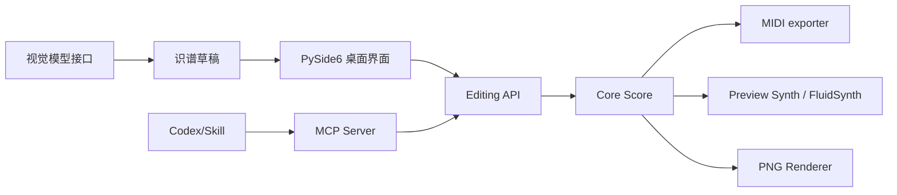

# Melody Notation 架构与路线图

## 核心设计原则

- 单一乐谱对象 `Score -> measures[] -> Note[]`，音频/MIDI/PNG 都从同一权威数据模型生成。
- Codex MCP 和本地 GUI 是**平等客户端**，不能把音乐算法写死在 Codex 提示词里。
- 原始简谱图像是证据来源，OMR 生成的是可更改的提议；每个小节需人审核。
- 中间格式可在后续兼容 MusicXML/MEI，以支持复音、符号与出版级排版。
- 内置合成器只是可用的离线预览；生产音色由外部授权的 SoundFont/VST 实现。

## 当前数据模型（v0.2）

```text
Score
  title : str
  key : str (如 C, G, Bb)
  bpm : int
  numerator : int
  denominator : int
  measures : list[Bar]

Bar = list[Note]
Note
  degree : 0..7 (0 为休止)
  octave : int (正数高八度，负数低八度)
  beats : float
  accidental : -1|0|1
  dotted : int
  token : 原始简谱记号文本
  slur_start : bool（乐句连音起点）
  slur_end : bool（乐句连音终点）
```

**提醒：**当前不是无损谱面标准。升降记号的作用域、声部、延音线 tie、倚音、力度和高级排版语义尚不完整；单层 slur 乐句线已支持，但暂未影响 MIDI 连奏演奏法。

## 系统流向



## MCP tools

DSH 通过同一个 MCP server 的 stdio 接口访问这些能力。

- `list_instruments()` — 音色列表
- `create_score(text,path,overwrite)` — 输入简谱并保存
- `inspect_score(path)` — 加载 JSON 或简谱并校验
- `replace_measure(path,measure_number,notes,overwrite)` — 精确编辑一个小节
- `export_audio(path,output,instrument,sf2,overwrite)` — WAV/MP3
- `export_midi(path,output,instrument,overwrite)` — MIDI
- `export_png(path,output,bars_per_row,overwrite)` — PNG
- `transcribe_image(image,output,model,overwrite)` — 视觉识谱成草稿
- `edit_note(path,measure_number,note_number,degree,octave,beats,accidental,overwrite)` — 逐音符修改
- `create_slur(path,start_measure,start_note,end_measure,end_note,overwrite)` — 跨小节乐句连音
- `remove_slur(path,measure_number,note_number,overwrite)` — 删除选中音符所属连音
- `insert_note(path,measure_number,insert_before,degree,beats,overwrite)` — 插入音符
- `delete_note(path,measure_number,note_number,overwrite)` — 删除音符

对已有文件使用 `overwrite=true` 才覆盖；`MELODY_WORKSPACE` 限定 MCP 文件读写目录。

## 后续优先级

### v0.2：已实现

逐音符点击选中、属性改动、插入删除、撤销重做、源文本同步、节拍错误标红、slur 连音线和 PNG 导出；尚未实现 tie 延音线与鼠标拖拽。

### v0.3：音源、轨道和格式

支持 SF2 音色浏览与预设保存、分轨、多乐器独立音轨、MusicXML 转换、可视化钢琴卷帘。

### v0.4：增强 OMR

图像校正 -> 行/小节检测 -> 多尺度音符识别 -> 音乐语法和节拍约束 -> 置信度热区 -> 人类校订 -> 回写。评估音高准确率、节奏准确率和小节完整率，形成 benchmark。

### v0.5：Melody Studio Agent 架构

计划工具、版本历史、可回滚编辑操作、审查/审批、试听回归、跨轨冲突与和声检测。

## 完成标准（v0.2 回归）

- 4/4 样例可输入并通过节拍校验。
- 可切换 piano/flute，并生成有明显音色差异的 WAV/MP3。
- MIDI 具有正确音高和开始/结束时间，包含乐器 Program Change 信息。
- PNG 输出显示基本简谱数字、上下八度点、时值下划线和小节线。
- OCR 返回草稿和不确定性说明，不自动标记为「准确」。
- Python 本地 MCP 函数模拟调用经过测试。真实 Codex / DeepSeek Harness MCP 握手仍需用户本机确认。

## v0.3.0：已实现的音轨与鼓点扩展

- `src/drums.py`：`.drum` 模型，16 步鼓点、三种 GM 鼓声、三套自合成鼓组
- `src/arrangement.py`：`.mtrack` 模型，保存多个 MIDI/鼓点轨道及不破坏原始乐谱的片段裁剪、反转和排序；混合 WAV/MP3、分轨 MIDI
- `src/multitrack_gui.py`：v0.3.0 的独立鼓点与多轨编辑窗口。当前桌面版由 `src/qt_gui.py` 在文档标签中打开这两类编辑器。
- `src/workspace.py`、`workspace_gui.py`：项目导航可新建、打开和重命名三种 Melody 文件；重命名素材会更新音轨工程引用
- `src/mcp_server.py`：新增可供 Codex / DeepSeek Harness 调用的鼓点及多轨管理工具

当前 `.jianpu` 仍是单旋律模型，多声部通过多个 `.jianpu` 轨道并行混音实现；自动和声生成器、AI 对话界面、钢琴卷帘尚未实现。
